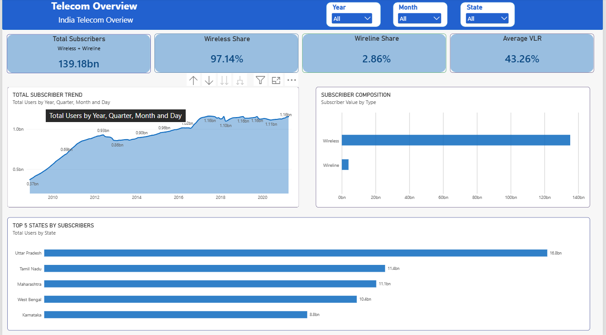
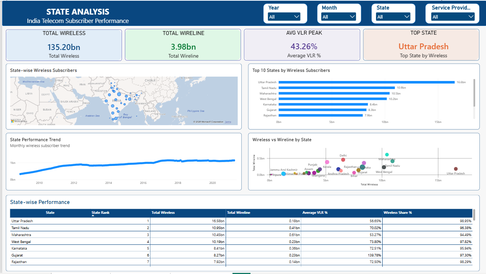
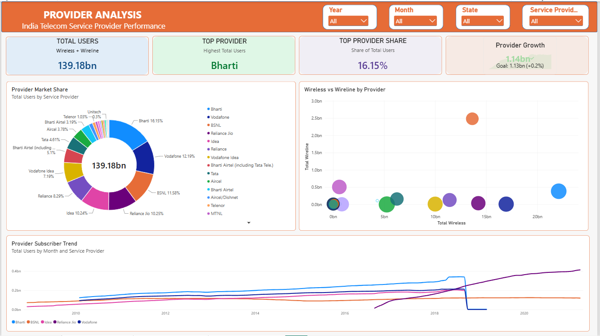

# 📊 Telecom Subscribers Analysis Dashboard

An interactive **Microsoft Power BI dashboard** developed to analyze telecom subscriber data across Indian states, telecom circles, service providers, and time periods.

The project transforms telecom data into meaningful business insights using interactive dashboards, KPIs, charts, maps, and filters.

---

## 📌 Project Overview

This project analyzes telecom subscriber data to understand:

- Wireless subscribers
- Wireline subscribers
- VLR Peak %
- State-level performance
- Service provider performance
- Subscriber trends over time
- Subscriber distribution

The dataset contains approximately **58,533 records**.

---

## 🎯 Objectives

- Analyze telecom subscriber trends
- Compare wireless and wireline subscribers
- Identify high-performing states
- Compare telecom service providers
- Analyze VLR performance
- Understand subscriber growth and distribution
- Create interactive dashboards for business analysis

---

## 📊 Dashboard Pages

### 1️⃣ Overview Dashboard

Provides a high-level view of overall telecom performance.

**Key Features:**
- Total subscriber KPIs
- Wireless vs Wireline comparison
- Subscriber trends
- State insights
- Provider insights
- Interactive filters



---

### 2️⃣ State Analysis

Focuses on subscriber performance across different states.

**Key Features:**
- State-wise subscriber analysis
- State ranking
- State map
- Wireless vs Wireline comparison
- VLR analysis
- Time-based trends



---

### 3️⃣ Provider Analysis

Focuses on telecom service provider performance.

**Key Features:**
- Total users
- Top provider
- Provider share
- Average VLR
- Provider comparison
- Wireless vs Wireline analysis
- Interactive filtering



---

## 📈 Key Metrics

- **Total Subscribers**
- **Wireless Subscribers**
- **Wireline Subscribers**
- **Average VLR**
- **Top Provider**
- **Top Provider Share %**

---

## 🛠️ Tools Used

- Microsoft Power BI
- Microsoft Excel
- SQL
- Power Query
- DAX
- Data Visualization

---

## 💡 Business Insights

The dashboard helps answer questions such as:

- Which states have the highest subscriber base?
- Which telecom providers have the most subscribers?
- How are wireless and wireline subscribers distributed?
- Which provider performs better across different states?
- How does VLR vary across states and providers?
- How does subscriber volume change over time?

---

## 📌 Business Value

This dashboard helps users:

- Monitor telecom performance
- Compare service providers
- Identify high-performing states
- Understand subscriber distribution
- Analyze market trends
- Support data-driven decisions

---

## 📁 Repository Structure

```text
Telecom-Subscribers-PowerBI/
│
├── Data/
│   └── telecom_clean.csv
│
├── PowerBI/
│   └── Telecom_Subscribers_Dashboard.pbix
│
├── Images/
│   ├── Telecom_Overview.png
│   ├── State_Analysis.png
│   └── Provider_Analysis.png
│
│── SQL/
│   │── Telecom.sql
│
└── README.md
```

---

## 🚀 Future Improvements

- Automated data refresh
- Market share analysis
- Year-over-year growth analysis
- Subscriber forecasting
- Advanced geographical analysis

---

## 👨‍💻 Author

**Rahul **

Interested in **Data Analytics, Business Intelligence, Power BI, SQL, Excel, Python, and Data Visualization.**

---

## ⭐ Project Highlights

This project demonstrates practical skills in:

**Data Cleaning → Data Analysis → Power BI → Business Intelligence**